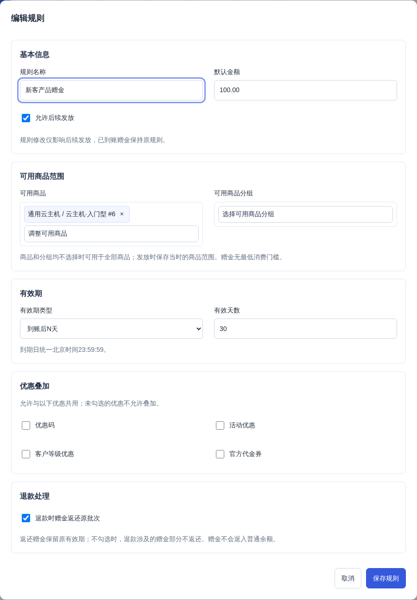
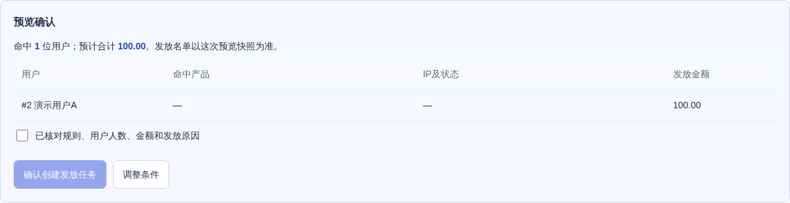
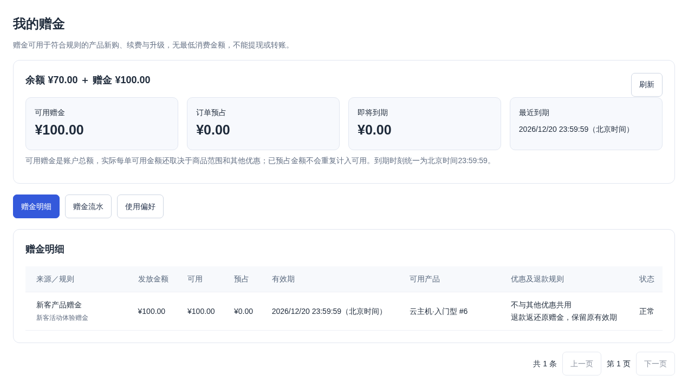
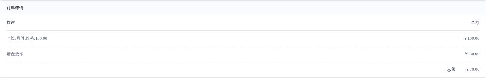
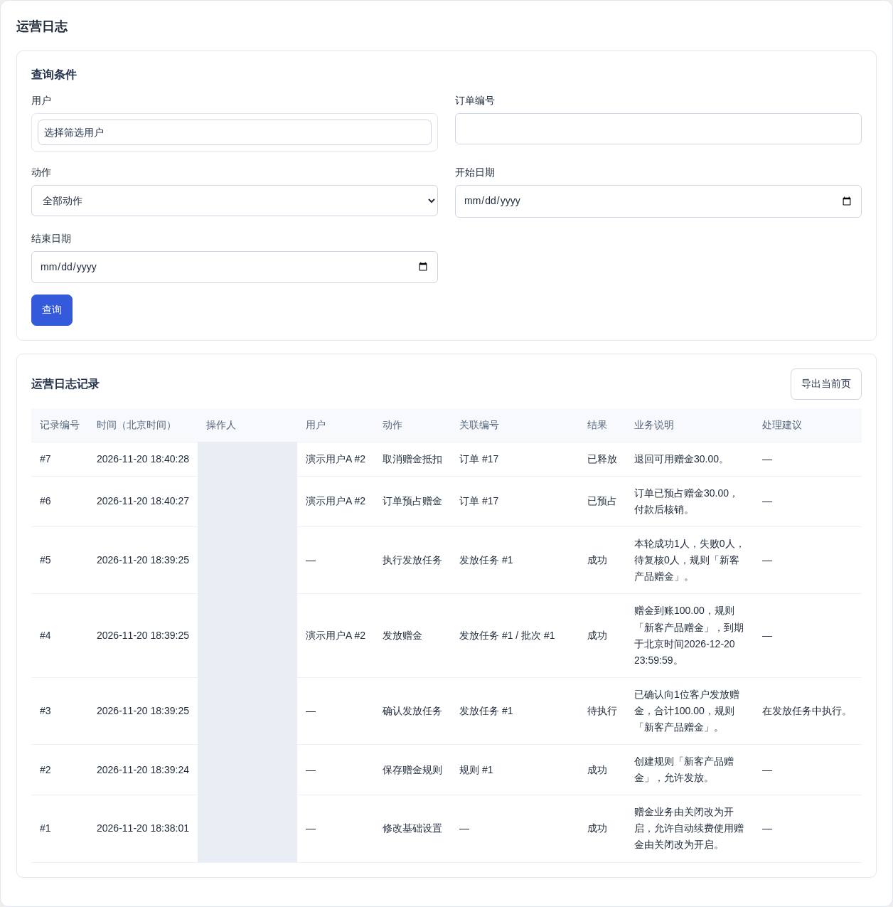

# 赠金

智简魔方 V10 的独立赠金账户插件。运营人员可以按活动创建规则、筛选用户并发放赠金，用户可在符合规则的订单中选择抵扣金额。

**首发测试版 1.0.1** · **作者 Cr** · QQ 793305720 · QQ 群 603107399

## 商品说明

| 功能 | 说明 |
| --- | --- |
| 独立赠金账户 | 前台显示普通余额和可用赠金，提供批次、到期时间、订单预占和流水查询。赠金不能提现或转入普通余额。 |
| 中文规则 | 可限制商品或商品分组，分别选择是否与优惠码、活动优惠、客户等级优惠和官方代金券叠加。 |
| 三种有效期 | 永久有效、指定到期日、到账后 N 天。到期日统一为北京时间 23:59:59。 |
| 批量发放 | 可按指定用户、用户状态或等级、商品与分组、产品实例、产品状态、精确 IP 或 IP 段筛选。支持按用户或按命中产品计发，可设置排除用户及单独金额。 |
| 自选抵扣 | 支持产品新购、续费及正差价升级。用户勾选后默认填入本单可用上限，也可以改成更少的金额。赠金无最低消费门槛。 |
| 订单净额 | 赠金以负抵扣明细计入订单，降低订单应付金额。例如商品 ¥100、赠金抵扣 ¥30，订单应付 ¥70。 |
| 退款规则 | 可按发放时的规则决定赠金是否返还原批次。返还保留原有效期。 |
| 运营工具 | 可核对发放预览、追踪任务结果、查询及管理批次、筛选运营日志、跳转页码、导出当前页。 |
| 插件联动 | 提供服务端赠金接口，可用于充值达标赠金等活动。可使用平台配置的邮件和短信动作处理到账通知与到期提醒。 |

适用范围为常规产品的新购、续费和正差价升级。充值、降级及插件服务类订单不支持抵扣。

## 适配环境

在 V10 10.7.4 官方桌面默认主题上完成了安装、发放和收银台抵扣验证。CRA1 收银台及官方移动主题 mfm201、mfm301 已通过组件联调。正式启用前，可在「赠金管理 → 基础设置」核对当前站点的兼容检查。

## 使用与界面

[查看安装和使用指南](docs/使用指南.md)

### 规则与发放

设置可用商品、有效期、优惠叠加和退款处理。发放前可按用户、产品和 IP 筛选，并预览人数和金额。

### 赠金中心与收银台

用户可查看可用、预占和即将到期的赠金，在收银台选择实际使用金额。

### 运营日志

按用户、订单、动作及日期查询，查看发放、抵扣与释放等操作结果。

