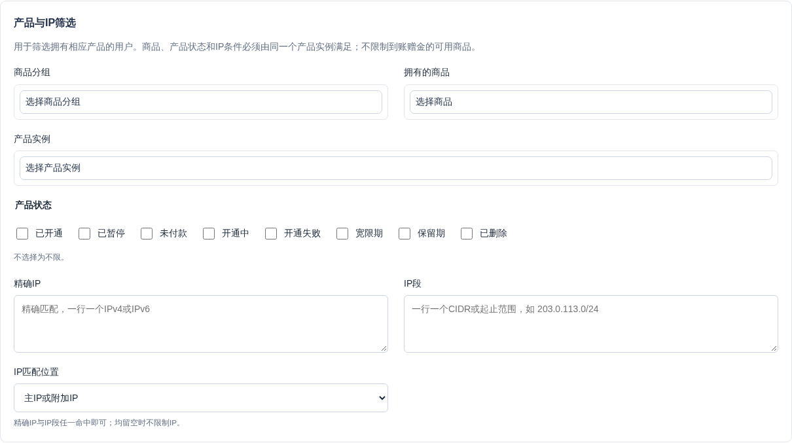
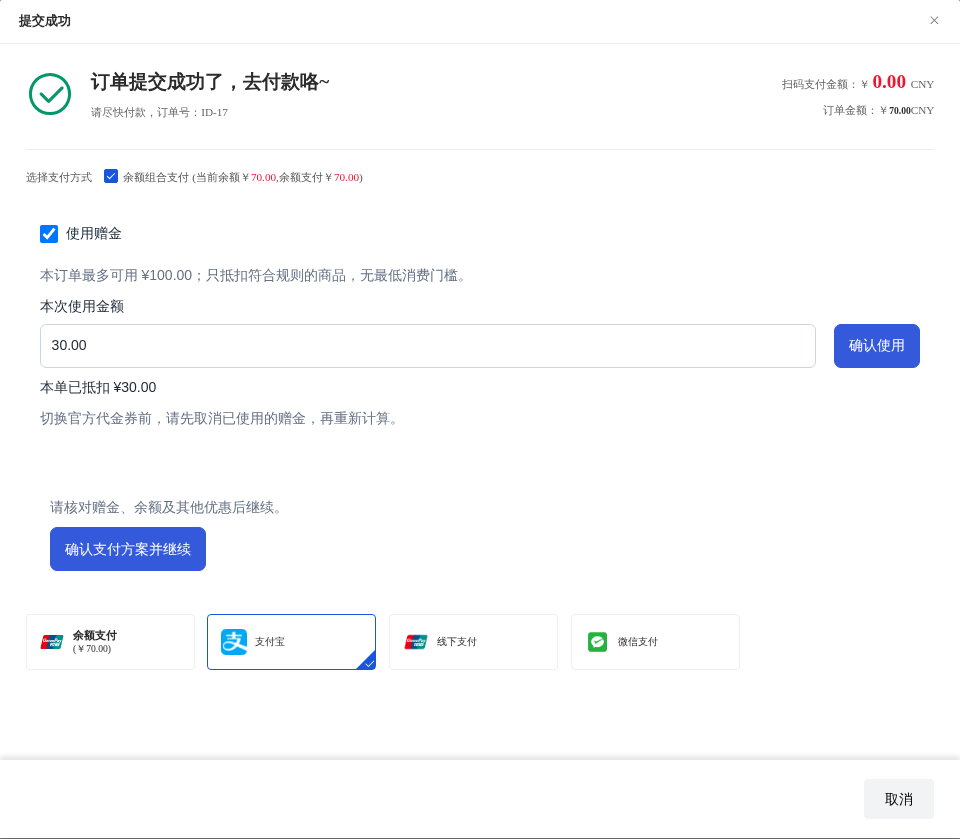

# 赠金 · Cr

**为智简魔方 V10 提供独立赠金账户、活动发放与订单抵扣**

按用户、产品或 IP 发放 · 用户自选抵扣金额 · 赠金计入订单抵扣明细

 

**[使用指南](docs/使用指南.md) · [界面预览](#界面预览) · [交流与反馈](#交流与反馈) · [相关项目](#相关项目)**

[功能亮点](#功能亮点) · [快速开始](#快速开始) · [适用范围](#适用范围)

## 关于赠金

赠金适用于充值活动、老客答谢和定向补偿。商家为每项活动设置可用商品、有效期、优惠叠加和退款规则，再按条件发放。会员在余额区域可同时查看普通余额和可用赠金。赠金单独记账，不可提现。

## 功能亮点

- **中文规则**可以限制商品或商品分组，分别控制是否与优惠码、活动优惠、等级优惠和官方代金券叠加。
- **三种有效期**支持永久、指定到期日或到账后 N 天。到期日统一为北京时间 23:59:59。
- **定向发放**支持指定用户、客户状态或等级，以及商品、产品实例、产品状态、精确 IP 或 IP 段，可排除指定用户或单独调整金额。
- **自选抵扣**无最低消费门槛，勾选后默认使用本单可用上限，也可手动减少。上限同时受可用赠金和适用商品金额约束。
- **订单净额**将赠金计入负抵扣明细。商品 ¥100，使用赠金 ¥30 后，订单应付 ¥70。
- **退款与预占**按发放规则决定赠金是否退回原批次并保留原有效期。未付订单回收后，释放的已到期赠金随即失效。
- **运营与联动**支持发放预览、任务跟踪、批次与流水、运营日志筛选及导出，提供其他插件可调用的发放接口。邮件和短信沿用 V10 通知渠道。

## 界面预览

点击查看大图。截图使用演示用户、商品和订单。

| 规则与有效期 | 发放预览 |
| :---: | :---: |
|  |  |
| **产品与 IP 筛选** | **运营日志** |
|  |  |
| **收银台自选抵扣** | **订单抵扣明细** |
|  |  |

[查看完整图文指南](docs/使用指南.md)

## 快速开始

1. 向开发者获取 **1.0.1 测试版**安装包，解压到 V10 的插件目录，并在后台「应用列表」安装赠金。
2. 进入「赠金管理 → 基础设置」开启业务，按需配置到账通知和到期提醒。
3. 新建活动规则，选择发放对象，核对预览后执行任务。
4. 使用测试会员核对「我的赠金」、收银台抵扣和订单净额，再开放给目标客户。

[安装与操作步骤](docs/使用指南.md)

## 适用范围

适用于常规产品新购、续费与正差价升级。充值、降级及插件服务类订单不参与抵扣。V10 10.7.4 官方桌面默认主题已验证安装、发放与收银台抵扣，CRA1 收银台及官方移动主题 mfm201、mfm301 已完成组件联调。

## 相关项目

| 项目 | 用途 |
| --- | --- |
| [酷锐 A1 主题（CRA1）](https://github.com/zbxh/cra1-theme-public) | 智简魔方 V10 的官网、会员中心与购物车主题。 |
| [补货订阅](https://github.com/zbxh/cr-stock-subscribe) | 开源插件，提供商品补货订阅、下架提醒和通知管理。 |
| [产品兑换码](https://github.com/zbxh/cr-product-redeem-showcase) | 按配置创建兑换批次，客户凭码开通服务器。 |
| [自助更换 IP](https://github.com/zbxh/cr-self-change-ip-showcase) | 为魔方云服务器提供主 IPv4 更换、报价和审核。 |
| [统一到期日期](https://github.com/zbxh/cr-unified-expiry-showcase) | 将多台服务器的到期日调整到同一日号，方便集中续费。 |

## 交流与反馈

- **开发者 Cr** · QQ **793305720** · QQ 群 **603107399**。[加入交流群](https://qm.qq.com/q/O3d7bVtcoS)
- 反馈时请附插件版本、V10 版本、使用主题和复现步骤。[提交问题](https://github.com/zbxh/cr-gift-credit-showcase/issues/new)
