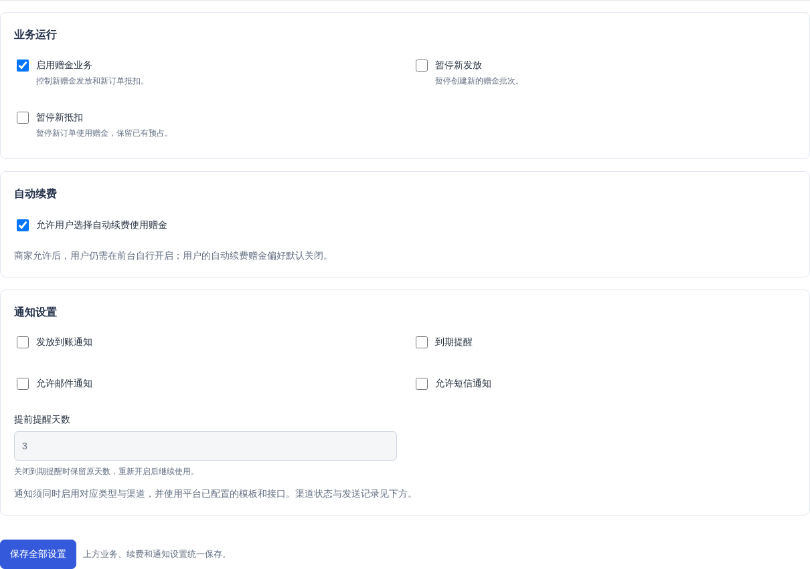

# 赠金使用指南

适用于赠金 1.0.1 测试版。图中使用演示用户、商品和订单。

## 1. 安装并启用

1. 解压安装包，将 `cr_gift_credit` 文件夹放入站点的 `public/plugins/addon/`。
2. 登录 V10 后台，打开「应用列表」，搜索「赠金」，点击该行的安装图标并确认。
3. 打开「赠金管理 → 基础设置」，勾选「启用赠金业务」，点击「保存全部设置」。可按需暂停新发放或新抵扣。
4. 在同页查看「兼容检查」。优惠和退款等联动依赖对应的 V10 功能或应用，按站点显示的检查结果使用。

[应用列表安装结果](../screenshots/00-install.png)

## 2. 创建并核对规则

在「规则管理」点击「新建规则」，填写中文名称。默认金额可以留空，也可在发放时调整。

1. 在「可用商品范围」选择商品或分组。两项留空时，规则适用于所有符合条件的常规产品订单。
2. 在「有效期」选择永久有效、指定到期日期或到账后 N 天。到期日统一为北京时间 23:59:59。
3. 勾选允许共用的优惠类型。未勾选的类型不可与该批次赠金叠加。
4. 按需开启「退款时赠金返还原批次」，保存规则。以后编辑规则只影响后续发放，已到账批次保留原规则。

[查看规则设置截图](../screenshots/02-rule.png)

## 3. 筛选用户并发放

1. 从规则列表点击「发放」，或打开「发放赠金」并选择规则，填写金额和原因。
2. 在「用户筛选」选择指定用户、等级或状态，按需设置排除用户。用户等级筛选需要 V10 客户等级插件。
3. 在「产品与IP筛选」可设置商品、商品分组、产品实例、产品状态、精确 IP 或 IP 段，并选择主 IP 或附加 IP。产品、状态和 IP 条件由同一个产品实例满足。所有筛选留空会面向全站用户。
4. 按用户发放时，同一用户去重。按命中产品发放时，金额按命中实例计发。指定用户可以单独填写金额。
5. 点击「预览发放名单」，核对用户、人数和合计，确认创建任务。在「发放任务」点击「执行／继续任务」，核对成功、失败和待复核数。重试沿用原任务，已成功的用户不会再次收到同一任务的赠金。

产品筛选用于挑选接收对象。赠金到账后的可用商品以规则中的「可用商品范围」为准。

[用户筛选](../screenshots/03-filters.png) · [产品与 IP 筛选](../screenshots/11-product-filters.png) · [发放预览](../screenshots/04-preview.png) · [任务结果](../screenshots/05-task.png)

## 4. 用户查看赠金和抵扣

1. 用户从会员中心余额区域进入「我的赠金」，查看可用金额、订单预占、各批次有效期和使用规则。
2. 打开符合规则的产品订单并进入收银台，勾选「使用赠金」。系统填入本单可用上限，受可用赠金、符合规则的商品金额及优惠叠加规则限制。
3. 可在「本次使用金额」填写更少的金额，点击「确认使用」。以商品 ¥100、使用赠金 ¥30 为例，订单显示赠金抵扣 −¥30，应付 ¥70。
4. 在支付未锁定时，可取消勾选并确认取消。已提交的预占订单可按原方案完成支付，即使期间赠金到期。若未支付且订单被回收，已到期赠金在释放后失效。
5. 商家在基础设置允许后，用户还可在「我的赠金 → 使用偏好」自行开启自动续费使用赠金。默认关闭。

[我的赠金](../screenshots/08-member.png) · [收银台抵扣](../screenshots/09-checkout.png) · [订单净额](../screenshots/10-order.png)

## 5. 管理批次、日志与退款

- **赠金批次**可按用户及状态查询，查看账户汇总、批次详情及使用金额，或填写原因后冻结、解冻和回收可回收部分。
- **赠金流水**用于核对金额变化。**运营日志**可按用户、订单编号、动作和日期查询，可跳转到指定页码或导出当前页。
- 普通资金和赠金混合支付时，通过站点支持的产品退款流程处理普通资金，赠金按原批次规则处理。
- 普通资金实付为零的全额赠金订单，可在「赠金退款」选择订单并填写退款比例和原因。退款涉及的赠金按原批次规则处理，商品停用需另行办理。

[赠金批次](../screenshots/06-batches.png) · [运营日志（操作人已遮盖）](../screenshots/07-operator-log.png)

## 6. 开启通知与活动联动

在基础设置选择「发放到账通知」或「到期提醒」，并启用邮件、短信渠道。模板和接口在 V10 的「通知设置」配置，短信使用已审核模板。赠金管理可查看平台发送动作，实际送达由平台通道处理。

活动插件可在确认业务成功后调用赠金服务端接口。例如活动规则为充值满 ¥200 赠送 ¥50，充值活动插件负责判断达标，赠金规则负责到账金额的使用范围和有效期。
